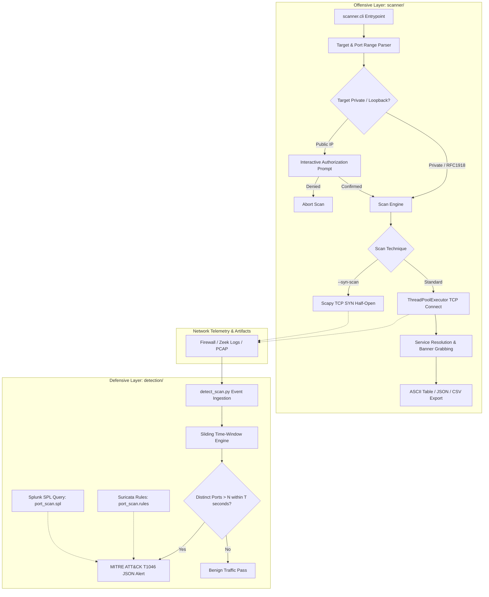
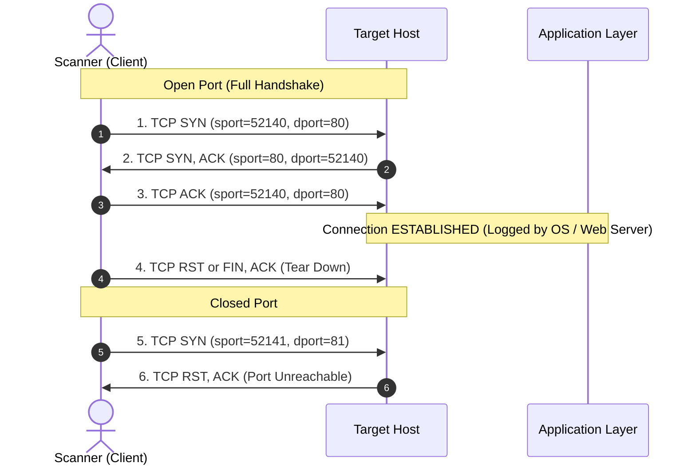
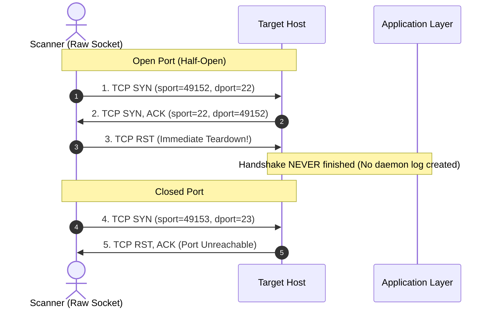

# SOC Port Scanner & Defensive Detection Suite

[](https://www.python.org/)
[](https://attack.mitre.org/techniques/T1046/)
[](tests/)
[](LICENSE)

An educational, dual-perspective cybersecurity portfolio project designed for **SOC Analyst**, **Detection Engineer**, and **Blue Team** roles. 

This repository bridges adversary simulation and defensive monitoring by implementing:
1. **The Attacker's Perspective (`scanner/`)**: A high-performance, multithreaded TCP port scanner with banner grabbing, rate limiting, port randomization, and an optional Scapy-based TCP SYN stealth scanner.
2. **The Defender's Perspective (`detection/`)**: A sliding time-window detection engine that ingests network logs (JSON, Syslog, CSV) or PCAPs, flags anomalous port scanning velocity, and generates structured alerts mapped to **MITRE ATT&CK T1046 (Network Service Discovery)**, accompanied by production-ready **Suricata NIDS** and **Splunk (SPL)** detection rules.

---

## Authorization & Legal Warning

> [!CAUTION]
> **AUTHORIZED TESTING ONLY**
> Port scanning without explicit prior written permission from the network and system owner is strictly illegal under international computer misuse laws (e.g., Computer Fraud and Abuse Act [CFAA 18 U.S.C. 1030] in the United States, Computer Misuse Act in the United Kingdom).
>
> This tool is strictly intended for educational research, defensive security engineering, and authorized lab environments (`localhost`, private RFC 1918 subnets, or dedicated permission targets like `scanme.nmap.org`). The scanner enforces an interactive confirmation gate whenever targeting public, non-private IP addresses.

---

## Architecture Overview



---

## Project Structure

```text
soc-port-scanner/
├── scanner/                      # Offensive Scanning Component
│   ├── __init__.py
│   ├── cli.py                   # Command-line interface with argparse & table rendering
│   ├── core.py                  # ThreadPoolExecutor connect scan, banner grabbing & rate limiter
│   ├── syn_scan.py              # Scapy-based TCP SYN stealth scan module
│   └── utils.py                 # Port range parsing, CIDR expansion & safety verification
├── detection/                    # Defensive Detection Component
│   ├── __init__.py
│   ├── detect_scan.py           # Sliding time-window scan detector & alert generator
│   ├── rules/
│   │   └── port_scan.rules      # Suricata NIDS detection rule (threshold by_src)
│   └── spl/
│       └── port_scan.spl        # Splunk SPL correlation search for SIEM deployments
├── samples/                      # Simulation & Test Datasets
│   ├── generate_sample_logs.py  # Script generating synthetic network traffic
│   └── network_traffic.log      # Sample dataset with benign traffic + injected attacks
├── tests/                        # Automated Test Suite (pytest)
│   ├── __init__.py
│   ├── test_scanner.py          # Port parser, CIDR, safety guard & socket scan tests
│   └── test_detector.py         # Log parser, sliding window, threshold & alert tests
├── requirements.txt             # Project dependencies (pytest, scapy)
├── .gitignore                   # Ignored artifacts & temporary files
└── README.md                    # Comprehensive documentation
```

---

## Installation & Setup

### Prerequisites
- Python 3.11 or higher
- Git

### Setup Virtual Environment
```bash
# Clone the repository
git clone https://github.com/your-username/soc-port-scanner.git
cd soc-port-scanner

# Create and activate a virtual environment
python -m venv .venv

# On Linux/macOS:
source .venv/bin/activate

# On Windows (PowerShell):
.venv\Scripts\Activate.ps1

# Install optional dependencies for testing and SYN scanning
pip install -r requirements.txt
```

> [!NOTE]
> The primary scanner and detection engine use **only Python's standard library** (`socket`, `argparse`, `concurrent.futures`, `ipaddress`, `json`, `collections`). `scapy` is only required for the optional `--syn-scan` flag and PCAP file analysis.

---

## Usage Guide

### 1. Offensive Scanner (`scanner/`)

#### Basic TCP Connect Scan
Scan default top-20 ports on localhost:
```bash
python -m scanner.cli 127.0.0.1
```

#### Scan Custom Port Ranges
Supports single ports, comma-separated lists, and hyphenated ranges:
```bash
python -m scanner.cli 127.0.0.1 --ports 21-25,80,443,8000-8080
```

#### Scan a CIDR Subnet with Thread Tuning
```bash
python -m scanner.cli 192.168.1.0/30 --ports 80,443,8080 --threads 100 --timeout 0.5
```

#### Evade Sequential Detection with Port Randomization & Throttling
```bash
python -m scanner.cli 192.168.1.10 --ports 1-1024 --randomize-ports --rate-limit 0.05
```

#### Export Scan Results to JSON or CSV
```bash
# Export to JSON
python -m scanner.cli 127.0.0.1 --ports 80,443,8080 -o scan_results.json

# Export to CSV
python -m scanner.cli 127.0.0.1 --ports 80,443,8080 -o scan_results.csv
```

#### Optional: TCP SYN (Stealth) Scan
*(Requires root on Linux/macOS or Administrator on Windows with Npcap)*
```bash
sudo python -m scanner.cli 192.168.1.10 --ports 22,80,443 --syn-scan
```

---

### 2. Defensive Detection Engine (`detection/`)

The detection component (`detect_scan.py`) analyzes connection logs or packet captures to identify single source IPs hitting an anomalous number of distinct ports within a configurable sliding time window.

#### Analyze Sample Log File
```bash
python -m detection.detect_scan samples/network_traffic.log --threshold 10 --window 60
```

#### Sample Alert Output
When a scan is detected, the engine outputs structured alerts and can export them to JSON:

```json
{
  "alert_id": "59b24f57-06d6-4e58-bac5-1bc3a9f4d413",
  "alert_timestamp": "2026-10-28T15:46:49.125430+00:00",
  "event_timestamp": "2026-10-28T15:42:21.006837+00:00",
  "source_ip": "192.168.1.185",
  "target_ip": "192.168.1.10",
  "distinct_ports_count": 11,
  "ports_hit": [21, 22, 23, 25, 53, 80, 110, 111, 135, 139, 143],
  "window_seconds": 60.0,
  "threshold": 10,
  "mitre_attack": {
    "tactic": "Discovery (TA0007)",
    "technique_id": "T1046",
    "technique_name": "Network Service Discovery",
    "reference": "https://attack.mitre.org/techniques/T1046/",
    "severity": "MEDIUM",
    "description": "Source IP 192.168.1.185 probed 11 distinct ports on 192.168.1.10 within 60.0s (Threshold > 10)."
  }
}
```

#### Generating Fresh Test Logs
You can simulate realistic background traffic with injected attacker scans using the bundled generator:
```bash
python -m samples.generate_sample_logs -o samples/network_traffic.log
```

---

## Blue Team View: Packet Analysis & Wireshark Signatures

Understanding how scanners appear on the wire is essential for a SOC analyst investigating reconnaissance activity.

### 1. TCP Connect Scan (Full 3-Way Handshake)



#### Wireshark Display Filter
```wireshark
ip.addr == 192.168.1.185 && tcp.flags.syn == 1 && tcp.flags.ack == 0
```

#### Key Blue Team Observations
1. **Application Log Footprint**: Because the OS completes the full TCP 3-way handshake before the scanner tears down the socket, web servers (Apache, Nginx, IIS) and application daemons log connection events (often recorded as `400 Bad Request` or empty 0-byte transactions).
2. **System Calls**: Uses unprivileged `connect()` system calls, making it runnable without root/administrator privileges.
3. **TCP Teardown**: Immediately following the `ACK`, standard sockets send a `RST` or standard `FIN/ACK` close sequence.

---

### 2. TCP SYN (Half-Open Stealth) Scan



#### Wireshark Display Filter
```wireshark
tcp.flags.reset == 1 && tcp.seq == 1
```

#### Key Blue Team Observations
1. **Evades Application Logs**: The 3-way handshake is never completed. The target OS kernel tracks the half-open connection in its SYN queue until the immediate `RST` arrives; application daemons (such as `sshd` or `httpd`) never receive an `accept()` event and write no logs.
2. **Network Sensor Footprint**: While invisible to application logs, half-open scans stand out starkly on network firewalls and NIDS (Suricata/Snort). A burst of unacknowledged SYN packets followed by immediate RST packets from the same client is an unmistakable signature of automated scanning.
3. **Privilege Requirements**: Requires raw socket creation (`SOCK_RAW`), necessitating root/administrative privileges.

---

## Detection Engineering Artifacts

### 1. Suricata NIDS Rule (`detection/rules/port_scan.rules`)
```suricata
alert tcp $EXTERNAL_NET any -> $HOME_NET any ( \
    msg:"SOC DETECT - Potential Network Service Discovery (T1046) - TCP SYN Port Scan"; \
    flags:S,12; \
    threshold: type both, track by_src, count 15, seconds 60; \
    classtype:attempted-recon; \
    metadata:mitre_tactic_id TA0007, mitre_tactic_name Discovery, mitre_technique_id T1046, mitre_technique_name "Network Service Discovery"; \
    reference:url,attack.mitre.org/techniques/T1046; \
    sid:2001046; \
    rev:1; \
)
```

### 2. Splunk Correlation Search (`detection/spl/port_scan.spl`)
```spl
| tstats `summariesonly`
    dc(All_Traffic.dest_port) as distinct_ports
    count as total_probes
    values(All_Traffic.dest_port) as sample_ports
    from datamodel=Network_Traffic.All_Traffic
    where All_Traffic.transport="tcp"
    by _time span=1m All_Traffic.src All_Traffic.dest
| rename All_Traffic.src as src_ip, All_Traffic.dest as dest_ip
| where distinct_ports > 15
| eval mitre_technique_id="T1046"
| eval mitre_technique_name="Network Service Discovery"
| eval mitre_tactic="Discovery (TA0007)"
| eval severity=case(
    distinct_ports > 100, "critical",
    distinct_ports > 50, "high",
    distinct_ports > 15, "medium",
    true(), "low"
)
| table _time, src_ip, dest_ip, distinct_ports, total_probes, severity, mitre_technique_id, sample_ports
```

---

## MITRE ATT&CK Mapping

| Attribute | Details |
| :--- | :--- |
| **Tactic** | [TA0007 - Discovery](https://attack.mitre.org/tactics/TA0007/) |
| **Technique** | [T1046 - Network Service Discovery](https://attack.mitre.org/techniques/T1046/) |
| **Description** | Adversaries may attempt to get a listing of services running on network-attached hosts to identify vulnerable software or map reachable infrastructure. |
| **Defensive Mitigation** | Network segmentation (M1030), disable unnecessary services, strict egress/ingress firewall ACLs. |
| **Detection Data Sources** | `Network Traffic: Network Traffic Flow`, `Network Traffic: Network Connection Creation`. |

---

## Automated Testing

The project includes unit and integration tests covering port parsing, CIDR expansion, authorization logic, rate limiting, socket scanning, and sliding-window detection.

Run all tests via `pytest`:
```bash
pytest tests/ -v
```

### Test Coverage Highlights
- **`tests/test_scanner.py`**:
  - Validates flexible port specifications (single, comma lists, ranges, bounds validation).
  - Validates IPv4, CIDR block calculations (`/30`, `/32`), and hostname resolution.
  - Verifies authorization confirmation prompts and bypass flags.
  - Verifies multithreaded scanning, banner grabbing, and rate limiting logic.
- **`tests/test_detector.py`**:
  - Validates ingestion across JSON, CSV, and Syslog log formats.
  - Verifies sliding time-window eviction so expired probes do not trigger false alerts.
  - Verifies threshold boundary conditions ($N$ vs $N+1$).
  - Verifies alert cooldown deduplication.

---

## Limitations & Ethical Considerations

1. **Firewall & NAT Evasion**: Advanced adversaries may employ distributed scanning (botnets) where each node scans only one port, evading single-source threshold detection. Detecting distributed scans requires horizontal correlation engines.
2. **SYN Scan Privileges**: Raw socket operations on modern operating systems require elevated privileges (`root` / `Administrator`) and appropriate packet capture drivers (Npcap on Windows, libpcap on Linux).
3. **Banner Grabbing Intrusiveness**: Active banner grabbing sends probe bytes to destination ports, which may crash fragile legacy embedded services or OT/SCADA equipment. In production lab testing, exercise extreme caution when scanning non-standard endpoints.
4. **Scope of Authorization**: Always ensure written Rules of Engagement (RoE) are formally executed prior to scanning any system you do not personally own and operate.
